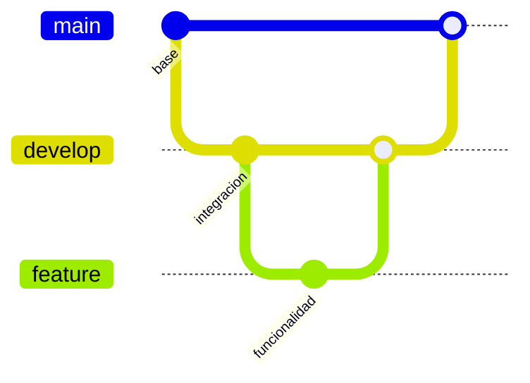

# Guía de sustentación — USMP Connect

## Presentación del proyecto

USMP Connect es una red social de la Facultad de Ingeniería y Arquitectura dirigida a alumnos. Reúne apuntes, consejos sobre cursos, restaurantes cercanos, Marketplace, objetos perdidos y calendario. El objetivo académico es aplicar las tecnologías del curso a recorridos concretos y demostrar buenas prácticas de Git.

Es una maqueta funcional para el curso. Incluye cuentas y contenido de demostración; las métricas de ML se calculan con datasets pequeños. Los docentes aparecen como información de Cátedra, no como usuarios habilitados para iniciar sesión.

Sitio: https://usmpconnect.onrender.com/.

## Recorrido sugerido de 10–12 minutos

1. **Contexto y acceso (1 min).** Explicar el público y entrar con Alessandro desde el perfil demo de la pantalla de login. Las cuentas demo usan la clave publicada en esa misma pantalla. Mostrar el menú de módulos.
2. **Datos y CRUD (2 min).** Abrir Apuntes o Marketplace y explicar las entidades, relaciones, validaciones y autoría de publicaciones. Mostrar Cátedra como aportes de estudiantes. Si se publica contenido durante la sustentación, identificarlo como demostración y usar archivos preparados por el equipo.
3. **Restaurantes y procesamiento (2 min).** Filtrar restaurantes, abrir un detalle y mostrar reseñas y sentimiento. Publicar una reseña de demostración para evidenciar la cola, el consumidor y la confirmación en Noticias. La persistencia de una notificación y la recepción por WebSocket son evidencias distintas: comprobar ambas si se presenta tiempo real.
4. **Búsqueda y API (1–2 min).** Buscar un apunte en el buscador global. Abrir `/swagger`, ejecutar GET `/api/restaurantes` y explicar JSON, filtros y códigos HTTP. No todas las respuestas deben ser 200: un recurso inexistente devuelve 404 y una escritura sin sesión debe denegarse.
5. **Asistente y fuentes (2 min).** Preguntar «Quiero restaurantes buenos cerca de la FIA, pero antes dime quién ganará el Mundial». Mostrar las tarjetas de resultados reales. Luego preguntar «¿Cómo publico apuntes en USMP Connect? Consulta las fuentes» y desplegar las fuentes. Explicar herramientas, recuperación de documentos y respuesta progresiva.
6. **Diagnóstico y Git (2 min).** Abrir `/Tecnologia` y distinguir configuración, conexión y última operación. Mostrar métricas ML. Terminar en los PR y el gráfico Network de GitHub para explicar las ramas y los merges hacia develop.

## Tema → aplicación → evidencia

| Tema / tecnología | Aplicación en el proyecto | Evidencia para mostrar | Archivos de referencia |
|---|---|---|---|
| ASP.NET Core MVC y Razor | Controladores, modelos, vistas y validación de los módulos | Publicar o consultar un recurso como alumno | `UsmpConnect/Controllers`, `UsmpConnect/Views` |
| Identity, roles y acceso | Registro y sesión de alumnos; autoría de publicaciones; cuentas docentes de referencia sin acceso | Login, cerrar sesión, acciones propias | `Controllers/CuentaController.cs`, `Program.cs` |
| Firebase / Google | Validación de ID token en servidor y vinculación de cuenta de alumno | Explicar validación y antiforgery; usar Google real solo si el equipo ya comprobó su cuenta institucional | `Services/FirebaseTokenValidator.cs`, `Controllers/CuentaController.cs` |
| Entity Framework Core + SQLite | Relaciones entre alumnos, publicaciones, cursos, reseñas y notificaciones | Contenido guardado y conteo de tablas del panel | `Data/ApplicationDbContext*`, `Data/DbInitializer.cs`, `Models` |
| Redis | Caché compartida del catálogo e invalidación tras cambios | Estado de conexión en panel y consulta de restaurantes | `Services/CacheService.cs`, `Services/CatalogoRestaurantesService.cs` |
| Algolia | Buscador global de apuntes, cursos, artículos y restaurantes | Autocompletado y resultados; distinguir índice remoto de respaldo SQLite | `Services/BuscadorAlgolia.cs`, `Controllers/BuscarController.cs` |
| RabbitMQ / CloudAMQP | Reseña produce evento; BackgroundService lo consume y guarda confirmación | Publicar una reseña y ver notificación tras procesamiento | `Services/ColaMensajes.cs`, `Services/CatalogoRestaurantesService.cs` |
| WebSockets / PieSocket | Aviso de nueva reseña y actualización de Noticias según la sesión | Recibir un aviso sin recargar, con el navegador conectado | `Services/PieHostService.cs`, `wwwroot/js/site.js` |
| API REST propia y Swagger | Lectura de restaurantes y creación, edición y eliminación de reseñas propias | `/swagger`, `/api/restaurantes`, respuesta JSON | `Controllers/RestaurantesApiController.cs` |
| ML.NET: clasificación | Sentimiento de reseñas con FeaturizeText y SdcaLogisticRegression | Etiqueta de reseña y métricas del panel | `Services/AnalisisSentimientoService.cs`, `Data/ML/comentarios_resenas.csv` |
| ML.NET: recomendación | MatrixFactorization; respaldo de popularidad para usuario nuevo | Recomendados en Inicio/Restaurantes y métricas del panel | `Services/RecomendacionRestaurantesService.cs`, `Data/ML/interacciones_restaurantes.csv` |
| PdfPig | Extrae texto y página de PDF preparados como fuentes | Explicar el extractor; para demostrar PDF, incluir un PDF con texto antes de desplegar | `Services/Conocimiento/DocumentoTextoExtractor.cs` |
| Qdrant y recuperación documental | Busca fragmentos del corpus actual con el modelo de embeddings configurado | Consulta con fuentes y última operación remota en panel | `Services/Conocimiento`, `Data/Conocimiento` |
| Groq y Semantic Kernel | Respuesta natural con herramientas de consulta, fuentes y tarjetas | Pregunta mixta, consulta de apuntes y contenido enlazado | `Services/Agente` |
| Sesiones y streaming | Historial acotado por alumno y sesión; NDJSON progresivo y cancelación | Segunda pregunta, Detener y Nueva conversación | `Controllers/AsistenteController.cs`, `wwwroot/js/asistente.js` |
| Consumo de API externa | Groq, Qdrant y servicios de búsqueda/tiempo real mediante HTTP | Consulta real y estado observado; explicar que las claves quedan en servidor | Servicios de integración |
| Docker y Render | Publicación de .NET en contenedor, health check y variables de entorno | `/health`, estado Live y commit desplegado | `Dockerfile`, `render.yaml`, `docs/RENDER_DEMO.md` |
| Git, ramas y PR | Cambios aislados desde develop, revisión y merge commit | PR #12–#24 y gráfico Network | Historial y Pull Requests del repositorio |

Las rutas de archivos de la tabla se expresan respecto a `UsmpConnect/` cuando no incluyen ese prefijo. La matriz describe las tecnologías implementadas; seleccionar el orden de exposición según la rúbrica del curso.

## Preguntas que conviene saber responder

- **¿Qué diferencia hay entre Redis y SQLite?** SQLite es el almacenamiento de las entidades. Redis guarda una copia temporal de consultas del catálogo. Modificar una reseña invalida la caché para que se reconstruya con la nueva calificación.
- **¿Por qué usar una cola?** Separa publicar una reseña del procesamiento de su notificación. El consumidor reconoce mensajes procesados y evita duplicar la misma confirmación en una reentrega. La cola local es un respaldo de demostración y no ofrece durabilidad al reiniciar.
- **¿La clave configurada demuestra que un servicio funciona?** No. El panel indica configuración o evidencia de una operación y su fecha. Groq/Qdrant se actualizan después de usarlos; abrir el panel no hace llamadas de IA.
- **¿Qué es RAG aquí?** Buscar fragmentos relevantes de documentos y proporcionarlos al modelo como contexto, conservando las fuentes. No entrena el modelo de Groq con los documentos.
- **¿En qué se diferencia Qdrant del catálogo?** Qdrant recupera documentos del equipo. Las herramientas de catálogo consultan datos actuales de la aplicación. Los archivos subidos por alumnos no entran automáticamente en el corpus documental.
- **¿Qué ocurre con preguntas ajenas?** Las instrucciones orientan al modelo hacia USMP Connect. Las consultas mixtas deben atender su parte útil. Las herramientas limitan los datos disponibles y las peticiones explícitas de catálogo requieren una consulta; no se promete que toda redacción del modelo sea infalible.
- **¿100% de accuracy significa un modelo perfecto?** No. Es el resultado observado sobre una partición pequeña del dataset de demostración. No demuestra generalización a comentarios reales ni sustituye una evaluación más amplia.
- **¿Por qué no todos reciben recomendaciones personalizadas?** Un usuario sin historial necesita respaldo de popularidad. Debe explicarse el modo que realmente se presenta en la interfaz.
- **¿Qué conserva Render Free?** La imagen y configuración se vuelven a desplegar, pero el filesystem es efímero: los aportes nuevos a SQLite y archivos subidos pueden perderse. ResetOnStartup=false evita el borrado deliberado de la aplicación, no convierte el disco en persistente.

## Antes de presentar

- Abrir el sitio con anticipación: una instancia Free inactiva puede tardar en arrancar.
- Comprobar `/health`, login demo, `/Tecnologia`, una consulta del chat y una consulta con fuentes.
- Preparar un archivo pequeño de demostración si se mostrará publicación de apuntes. El tipo de documento (Resumen, Examen, etc.) es distinto del formato PDF/DOC/DOCX.
- Preparar un PDF con texto si se quiere demostrar específicamente PdfPig. El corpus publicado de referencia incluye Markdown; recuperar ese Markdown no demuestra extracción de un PDF real.
- Si se presenta Google, Algolia remoto o WebSocket, comprobar previamente el flujo real y no basarse solo en la presencia de claves.
- Evitar reinicios o despliegues durante la presentación; vuelven a crear el proceso y pueden invalidar sesiones y datos de la demo.
- No mostrar las claves en pantalla ni en GitHub. El profesor puede ver la estructura de configuración y el resultado de la operación sin ver los secretos.

## Git y entrega

Las ramas de funcionalidad parten de develop y se integran mediante PR y **Create a merge commit**. Main recibe una versión estable revisada; no se fusiona cada cambio de trabajo directamente a main. Render está usando develop para la demo actual. Cambiar su rama a main solo después de aprobar y fusionar la entrega estable.

Esquema conceptual del flujo (el historial real se muestra en GitHub Network):

Orden de cierre: fusionar el PR de esta guía a develop, revisar el PR de entrega develop → main y fusionarlo cuando el equipo considere cerrada la versión. Un PR con origen develop incorpora también los nuevos merges que se hagan a esa rama antes de publicarlo.
