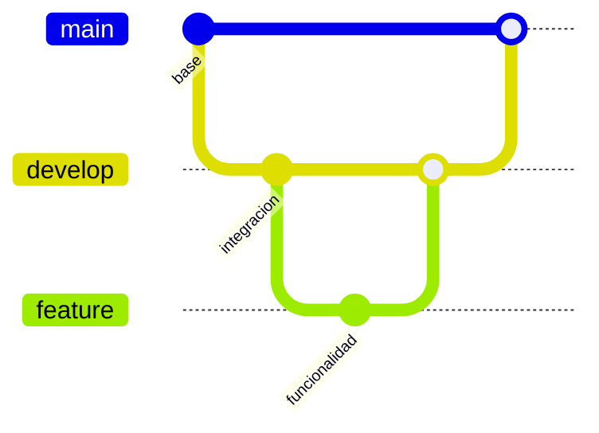

# Guía de sustentación — USMP Connect

## Presentación del proyecto

USMP Connect es una red social de la Facultad de Ingeniería y Arquitectura dirigida a alumnos. Reúne apuntes, consejos sobre cursos, restaurantes cercanos, Marketplace, objetos perdidos y calendario. El objetivo académico es aplicar las tecnologías del curso a recorridos concretos y demostrar buenas prácticas de Git.

Es una maqueta funcional para el curso. Incluye cuentas y contenido de demostración; las métricas de ML se calculan con datasets pequeños. Los docentes aparecen como información de Cátedra, no como usuarios habilitados para iniciar sesión.

Sitio: https://usmpconnect.onrender.com/.

## Recorrido sugerido de 10–12 minutos

1. **Contexto y acceso (1 min).** Explicar el público y entrar con Alessandro desde el perfil demo de la pantalla de login. Las cuentas demo usan la clave publicada en esa misma pantalla. Mostrar el menú de módulos.
2. **Datos y CRUD (2 min).** Abrir Apuntes o Marketplace y explicar las entidades, relaciones, validaciones y autoría de publicaciones. Mostrar Cátedra como aportes de estudiantes. Si se publica contenido durante la sustentación, identificarlo como demostración y usar archivos preparados por el equipo.
3. **Restaurantes, Redis, ML.NET, RabbitMQ y WebSocket en vivo (2–3 min).** Entrar a `/Restaurantes`, mostrar el indicador `Catálogo: SQLite` / `Catálogo: Redis Cache` al recargar o filtrar, y la franja de recomendados personalizados (`SUGERENCIAS PARA TI` con Matrix Factorization). Abrir un restaurante, publicar una reseña de demostración y ver:
   - La etiqueta de sentimiento `Positivo · XX%` o `Negativo · XX%` calculada con `ML.NET`.
   - Los botones **Editar** (`PUT /api/resenas/{id}`) y **Eliminar** (`DELETE /api/resenas/{id}`) directamente en la reseña propia para demostrar cómo al editar el texto se reclasifica el sentimiento en vivo e invalida la caché de Redis. El indicador conserva el origen de la carga inicial del catálogo; abrir el detalle no lo cambia. Recargar para observar una nueva consulta, teniendo en cuenta que otra petición puede haber reconstruido la caché.
   - La notificación generada por el consumidor de **RabbitMQ / CloudAMQP** en la campana y el aviso en tiempo real por **PieSocket WebSocket**.
4. **Búsqueda y API (1–2 min).** Buscar un apunte o restaurante en el buscador global (**Algolia**). Abrir `/swagger`, ejecutar `GET /api/restaurantes` y explicar JSON, filtros y códigos HTTP (`200`, `201`, `204`, `401`, `403`, `404`).
5. **Asistente FIA, Semantic Kernel, Qdrant y PdfPig (2 min).** Con la sesión de alumno iniciada, abrir el botón flotante **Asistente FIA**, abajo a la derecha. No aparece sin sesión ni en la pantalla de login:
   - Preguntar «Quiero restaurantes buenos cerca de la FIA, pero antes dime quién ganará el Mundial» para demostrar **Semantic Kernel + Groq** ejecutando el plugin `CatalogoFia` y dibujando las tarjetas reales de la base de datos mientras filtra el tema ajeno.
   - Hacer clic en el botón **«Manual FIA (PDF)»** (o preguntar por la calculadora de promedios y edición de reseñas) y desplegar las fuentes verificadas al pie de la respuesta: comprobar qué páginas recuperó la consulta (`manual-fia-usmp-connect.pdf · página 1` o `página 2`), demostrando **PdfPig** extrayendo páginas reales de un PDF y **Qdrant** recuperando los fragmentos semánticos.
6. **Diagnóstico y Git (1–2 min).** Si el docente solicita ver métricas numéricas (AUC, F1, RMSE), abrir `/Tecnologia`. Terminar en los PR y el gráfico Network de GitHub para explicar las ramas y los merges hacia `develop` y `main`.

## Tema → aplicación → evidencia

| Tema / tecnología | Aplicación en el proyecto | Evidencia para mostrar | Archivos de referencia |
|---|---|---|---|
| ASP.NET Core MVC y Razor | Controladores, modelos, vistas y validación de los módulos | Publicar o consultar un recurso como alumno | `UsmpConnect/Controllers`, `UsmpConnect/Views` |
| Identity, roles y acceso | Registro y sesión de alumnos; autoría de publicaciones; cuentas docentes de referencia sin acceso | Login, cerrar sesión, acciones propias | `Controllers/CuentaController.cs`, `Program.cs` |
| Firebase / Google | Validación de ID token en servidor y vinculación de cuenta de alumno | Explicar validación y antiforgery; usar Google real solo si el equipo ya comprobó su cuenta institucional | `Services/FirebaseTokenValidator.cs`, `Controllers/CuentaController.cs` |
| Entity Framework Core + SQLite | Relaciones entre alumnos, publicaciones, cursos, reseñas y notificaciones | Contenido guardado y conteo de tablas del panel | `Data/ApplicationDbContext*`, `Data/DbInitializer.cs`, `Models` |
| Redis | Caché compartida del catálogo e invalidación tras cambios | Indicador `Catálogo: Redis Cache` / `Catálogo: SQLite` en `/Restaurantes` al recargar y tras reseñar | `Services/CacheService.cs`, `Services/CatalogoRestaurantesService.cs` |
| Algolia | Buscador global de apuntes, cursos, artículos y restaurantes | Autocompletado instantáneo en la barra superior (`/Buscar/Sugerencias`) | `Services/BuscadorAlgolia.cs`, `Controllers/BuscarController.cs` |
| RabbitMQ / CloudAMQP | Reseña produce evento; BackgroundService lo consume y guarda confirmación | Publicar una reseña y ver notificación persistida en la campana | `Services/ColaMensajes.cs`, `Services/CatalogoRestaurantesService.cs` |
| WebSockets / PieSocket | Aviso de nueva reseña y actualización de Noticias según la sesión | Recibir toast en vivo sin recargar la página | `Services/PieHostService.cs`, `wwwroot/js/site.js` |
| API REST propia y Swagger | Lectura de restaurantes y creación, edición (`PUT`) y eliminación (`DELETE`) de reseñas propias | Botones **Editar** y **Eliminar** en el modal de `/Restaurantes` y `/swagger` | `Controllers/RestaurantesApiController.cs`, `Views/FoodSpots/Index.cshtml` |
| ML.NET: clasificación | Sentimiento de reseñas con FeaturizeText y SdcaLogisticRegression | Badge `Positivo · XX%` / `Negativo · XX%` en cada reseña (y reclasificación al editar) | `Services/AnalisisSentimientoService.cs`, `Data/ML/comentarios_resenas.csv` |
| ML.NET: recomendación | MatrixFactorization; respaldo de popularidad para usuario nuevo | Recomendados personalizados en `/` y `/Restaurantes` que cambian según el alumno | `Services/RecomendacionRestaurantesService.cs`, `Data/ML/interacciones_restaurantes.csv` |
| PdfPig | Extrae texto y número de página de documentos PDF del corpus (`manual-fia-usmp-connect.pdf`) | Cita verificada `Fuente: manual-fia-usmp-connect.pdf · página 1 / página 2` en el Asistente FIA | `Services/Conocimiento/DocumentoTextoExtractor.cs`, `Data/Conocimiento/manual-fia-usmp-connect.pdf` |
| Qdrant y recuperación documental | Busca fragmentos del corpus actual con el modelo de embeddings configurado | Desplegable de fuentes en el Asistente FIA y `/Conocimiento/Buscar` | `Services/Conocimiento`, `Data/Conocimiento` |
| Groq y Semantic Kernel | Respuesta natural con herramientas de consulta, fuentes y tarjetas | Pregunta mixta, consulta de apuntes/restaurantes y tarjetas interactivas | `Services/Agente` |
| Sesiones y streaming | Historial acotado por alumno y sesión; NDJSON progresivo y cancelación | Segunda pregunta, Detener y Nueva conversación | `Controllers/AsistenteController.cs`, `wwwroot/js/asistente.js` |
| Consumo de API externa | Groq, Qdrant y servicios de búsqueda/tiempo real mediante HTTP | Consulta real en el chat y buscador; claves protegidas en servidor | Servicios de integración |
| Docker y Render | Publicación de .NET en contenedor, health check y variables de entorno | `/health`, estado Live y commit desplegado | `Dockerfile`, `render.yaml`, `docs/RENDER_DEMO.md` |
| Git, ramas y PR | Cambios aislados desde develop, revisión y merge commit | PRs y gráfico Network en GitHub | Historial y Pull Requests del repositorio |

Las rutas de archivos de la tabla se expresan respecto a `UsmpConnect/` cuando no incluyen ese prefijo. La matriz describe las tecnologías implementadas; seleccionar el orden de exposición según la rúbrica del curso.

## Preguntas que conviene saber responder

- **¿Qué diferencia hay entre Redis y SQLite?** SQLite es el almacenamiento de las entidades. Redis guarda una copia temporal de consultas del catálogo. Crear, editar o eliminar una reseña invalida la caché para que se reconstruya con la nueva calificación.
- **¿Por qué usar una cola?** Separa publicar una reseña del procesamiento de su notificación. El consumidor reconoce mensajes procesados y evita duplicar la misma confirmación en una reentrega. La cola local es un respaldo de demostración y no ofrece durabilidad al reiniciar.
- **¿La clave configurada demuestra que un servicio funciona?** No. El uso se demuestra ejecutando la acción real (publicar/editar reseña, buscar, preguntar al asistente) y observando el resultado.
- **¿Qué es RAG aquí?** Buscar fragmentos relevantes de documentos (`guia-usmp-connect.md` y `manual-fia-usmp-connect.pdf` extraído con `PdfPig`) y proporcionarlos al modelo como contexto, conservando las fuentes y páginas. No entrena el modelo de Groq con los documentos.
- **¿En qué se diferencia Qdrant del catálogo?** Qdrant recupera documentos del equipo. Las herramientas de catálogo consultan datos actuales de la aplicación. Los archivos subidos por alumnos no entran automáticamente en el corpus documental.
- **¿Qué ocurre con preguntas ajenas?** Las instrucciones orientan al modelo hacia USMP Connect. Las consultas mixtas deben atender su parte útil. Las herramientas limitan los datos disponibles y las peticiones explícitas de catálogo o manual requieren una consulta.
- **¿100% de accuracy significa un modelo perfecto?** No. Es el resultado observado sobre una partición pequeña del dataset de demostración. No demuestra generalización a comentarios reales ni sustituye una evaluación más amplia.
- **¿Por qué no todos reciben recomendaciones personalizadas?** El modelo utiliza el dataset de demostración; un usuario que no figura en ese entrenamiento recibe respaldo de popularidad. Crear o editar reseñas no reentrena automáticamente el modelo. Debe explicarse el modo que realmente se presenta en la interfaz.
- **¿Qué conserva Render Free?** La imagen y configuración se vuelven a desplegar, pero el filesystem es efímero: los aportes nuevos a SQLite y archivos subidos pueden perderse. ResetOnStartup=false evita el borrado deliberado de la aplicación, no convierte el disco en persistente.

## Antes de presentar

- Abrir el sitio con anticipación: una instancia Free inactiva puede tardar en arrancar.
- Comprobar `/health`, login demo, `/Restaurantes`, una consulta del chat con tarjetas y el botón «Manual FIA (PDF)» para mostrar `manual-fia-usmp-connect.pdf · página 1 / página 2`.
- Preparar un archivo pequeño de demostración si se mostrará publicación de apuntes. El tipo de documento (Resumen, Examen, etc.) es distinto del formato PDF/DOC/DOCX.
- Si se presenta Google, Algolia remoto o WebSocket, comprobar previamente el flujo real y no basarse solo en la presencia de claves.
- Evitar reinicios o despliegues durante la presentación; vuelven a crear el proceso y pueden invalidar sesiones y datos de la demo.
- No mostrar las claves en pantalla ni en GitHub. El profesor puede ver la estructura de configuración y el resultado de la operación sin ver los secretos.

## Git y entrega

Las ramas de funcionalidad parten de develop y se integran mediante PR y **Create a merge commit**. Main recibe una versión estable revisada; no se fusiona cada cambio de trabajo directamente a main.

Esquema conceptual del flujo (el historial real se muestra en GitHub Network):

## Mantener el manual PDF

El PDF está versionado en `UsmpConnect/Data/Conocimiento/manual-fia-usmp-connect.pdf`. Su fuente de autoría es `docs/scripts/generar_manual_fia.py` (requiere ReportLab solo para regenerarlo). Ejecutar `python docs/scripts/generar_manual_fia.py`, revisar sus dos páginas y versionar el resultado. Las pruebas leen el PDF copiado al compilar y nunca escriben ni recrean el corpus.

## Conversación y presupuesto referencial

El gasto promedio por persona se guarda en `Restaurante.PrecioPromedioReferencial`. Se amplía la tabla SQLite existente sin reiniciarla y se completan solo los importes ausentes según el rango demo: económico S/ 10, medio S/ 16 y premium S/ 25. Son estimaciones de la maqueta, no precios medidos. Se muestran en las tarjetas y detalle; no se requiere una carta de platos. La caché usa una nueva versión para no reutilizar objetos que carecen del campo.

Para demostrar: preguntar «Dónde almorzar por menos de 15, comida rápida» y luego «¿por 20?». La categoría se conserva y el presupuesto cambia. Preguntar «Antes de darme apuntes de cálculo haz Fibonacci en Python» devuelve directamente los apuntes de cálculo; la búsqueda estructurada se ejecuta con Semantic Kernel y su resultado se presenta sin pedir al modelo que resuelva la tarea ajena. Groq sigue redactando las consultas de restaurantes y de guía; no se atribuye una búsqueda estructurada de apuntes a una respuesta generada por IA.

La búsqueda de apuntes prioriza título y curso, después descripción; no extrae el contenido de todos los archivos. Si no existe Python en los metadatos, debe reconocerlo, no inventar materiales. «Funciones» tras preguntar por Python conserva ese contexto y muestra alternativas de otros temas claramente identificadas si no hay coincidencias.
